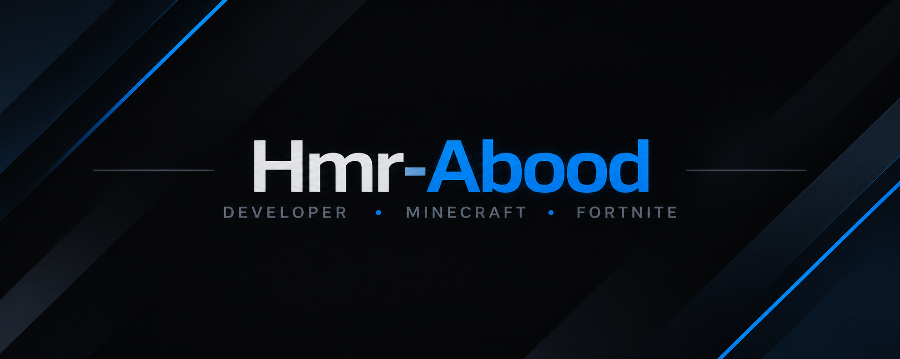

# Hmr-Abood

### Developer • Software Builder • Minecraft Developer

Building tools, custom systems, and software inspired by ideas worth bringing to life.

---

## About Me

I'm a developer interested in building practical software, gaming tools, and custom systems.

I enjoy taking an idea from concept to a working project, experimenting with different technologies, and finding creative solutions to technical problems.

- Developing Fortnite-related tools and utilities.
- Building custom Minecraft systems and gameplay mechanics.
- Creating Python applications and automation tools.
- Exploring software development and new technologies.

## Featured Projects

### Fortnite Chest Tracker

A replay-based Fortnite chest tracking tool designed to track chest openings, monitor progress, simulate Pirate Shop rolls, and help players understand their milestones.

### Minecraft Development

Custom Minecraft gameplay systems, Skript projects, interactive GUIs, automated events, and multiplayer mechanics.

### Python Tools

Desktop applications, utilities, data processing, automation, and gaming-related tools.

---

## Tech Stack

**Languages**

**Tools & Technologies**

---

## GitHub Statistics

---

## Currently Exploring

- Desktop application development
- Game data analysis
- Software architecture
- Automation and tooling
- New programming technologies

---

### Thanks for visiting!

Feel free to explore my repositories and check out what I'm building.

